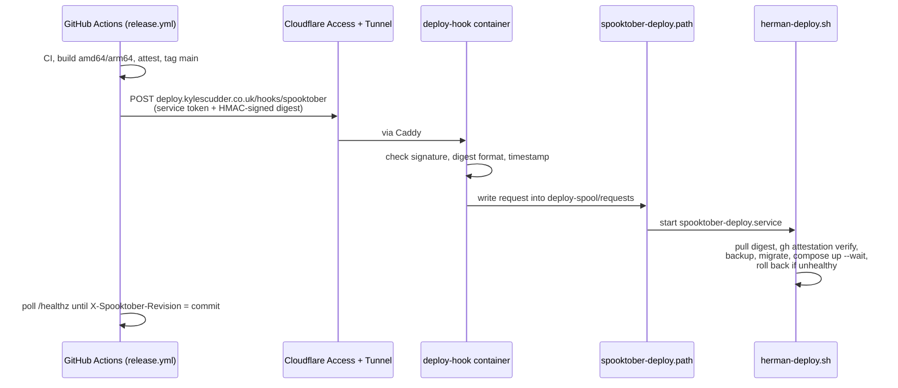

# Handover — automatic Spooktober deploys on Herman

Prepared 11 October 2026. Nothing in this document has been run on Herman. Carry it out on `herman-1` after verifying the host identity. It assumes the Hermes platform ([Plan 1](hermes-infrastructure-plan.md)) is in service and Spooktober has been provisioned on it ([Plan 2](spooktober-setup-plan.md)): database and roles exist, `.env` and `.env.migration` are in place, and the list has been seeded or imported.

**Result:** every merge to `main` is deployed to <https://spooktober.kylescudder.co.uk> straight away, without polling and without giving GitHub shell access or production credentials.

## How it works



| Component | Source | Runs as | Can do |
|---|---|---|---|
| `deploy` job | `.github/workflows/release.yml` | GitHub-hosted runner, `production` environment | Send one signed request naming a digest |
| Receiver | `deploy/receiver/server.mjs`, `deploy/compose.deploy-hook.yaml` | `node:22-alpine`, read-only, no capabilities, `spooktober-deploy` uid | Write a request file into the spool. No Docker socket, no database access |
| Trigger | `deploy/spooktober-deploy.path` | systemd | Start the service when a request arrives |
| Deployer | `deploy/herman-deploy.sh`, `deploy/spooktober-deploy.service` | `spooktober-deploy` user in the `docker` group | Verify, back up, migrate, deploy, roll back |

**Security model.** The internet-facing receiver cannot touch Docker; it can only queue a digest. The deployer independently refuses any image whose provenance attestation was not produced by `release.yml` from `refs/heads/main` on a GitHub-hosted runner. A leaked webhook secret or Access token therefore lets someone, at most, redeploy an image this repository's release workflow already built from `main`. The webhook secret and Access token live only in the GitHub `production` environment, restricted to `main`. Membership of the `docker` group is root-equivalent, so `spooktober-deploy` must remain a non-login system account with private files.

## Values

| Item | Value |
|---|---|
| App checkout | `/srv/apps/spooktober` (this repository, `main`) |
| Image | `ghcr.io/kylescudder/spooktober` (public; no registry login needed) |
| Deploy hostname | `deploy.kylescudder.co.uk` |
| Webhook path | `POST /hooks/spooktober` → `spooktober-deploy-hook:9000` on the platform web network |
| Deploy user | `spooktober-deploy` (system account, home `/var/lib/spooktober-deploy`) |
| Spool | `/srv/apps/spooktober/deploy-spool/{tmp,requests}` |
| Webhook secret file | `/srv/apps/spooktober/secrets/deploy-webhook-secret` |
| GitHub environment | `production`, deployments from `main` only |
| GitHub environment secrets | `DEPLOY_WEBHOOK_SECRET`, `CF_ACCESS_CLIENT_ID`, `CF_ACCESS_CLIENT_SECRET` |
| GitHub repository variable | `DEPLOY_ENABLED=true` switches the deploy job on |

Substitute the platform handoff's actual network names and paths wherever they differ. Never paste secret values into chat, tickets, logs or this document.

## 1. Update the checkout and install the GitHub CLI

```sh
cd /srv/apps/spooktober
sudo git fetch origin && sudo git switch main && sudo git pull --ff-only
```

Install the [GitHub CLI](https://github.com/cli/cli/blob/trunk/docs/install_linux.md) from GitHub's apt repository. It is used only for `gh attestation verify`.

## 2. Create the deploy account and directories

```sh
sudo useradd --system --home-dir /var/lib/spooktober-deploy --shell /usr/sbin/nologin spooktober-deploy
sudo install -d -o spooktober-deploy -g spooktober-deploy -m 700 \
  /srv/apps/spooktober/state /srv/apps/spooktober/backups /srv/apps/spooktober/secrets \
  /srv/apps/spooktober/deploy-spool /srv/apps/spooktober/deploy-spool/tmp /srv/apps/spooktober/deploy-spool/requests
sudo chown spooktober-deploy:spooktober-deploy /srv/apps/spooktober/.env /srv/apps/spooktober/.env.migration
sudo chmod 600 /srv/apps/spooktober/.env /srv/apps/spooktober/.env.migration
id spooktober-deploy    # note the uid and gid for step 4
```

If the platform keeps project secrets elsewhere, keep them there and adjust the paths in `deploy/compose.deploy-hook.yaml` (via `DEPLOY_WEBHOOK_SECRET_FILE`) and the service unit. The deployer only needs to read `.env` (for `PLATFORM_DB_NETWORK` and Compose interpolation) and `.env.migration`.

## 3. Create the webhook secret

Generate it on Herman so it never travels through chat:

```sh
sudo -u spooktober-deploy sh -c 'umask 077; openssl rand -hex 32 > /srv/apps/spooktober/secrets/deploy-webhook-secret'
```

Copy the same value into GitHub without displaying it, from a machine with `gh` authenticated as a repository admin, for example by piping it over SSH:

```sh
ssh herman-1 'sudo cat /srv/apps/spooktober/secrets/deploy-webhook-secret' \
  | gh secret set DEPLOY_WEBHOOK_SECRET --env production --repo kylescudder/spooktober
```

## 4. Start the webhook receiver

Create `/srv/apps/spooktober/.env.deploy-hook` (owner `spooktober-deploy`, mode 600):

```text
DEPLOY_HOOK_USER=<uid>:<gid>
PLATFORM_WEB_NETWORK=<actual shared web network>
```

```sh
cd /srv/apps/spooktober
sudo docker compose -f deploy/compose.deploy-hook.yaml --env-file .env.deploy-hook up -d
sudo docker compose -f deploy/compose.deploy-hook.yaml --env-file .env.deploy-hook ps   # healthy
```

The container publishes no host ports. It runs `node:22-alpine` with the receiver mounted read-only.

## 5. Route `deploy.kylescudder.co.uk`

Use the platform's hostname-registration command so DNS, tunnel and Caddy stay consistent. Expose only the webhook path:

```caddyfile
http://deploy.kylescudder.co.uk {
    handle /hooks/spooktober {
        reverse_proxy spooktober-deploy-hook:9000
    }
    respond 404
}
```

## 6. Protect the hostname with Cloudflare Access

In Cloudflare Zero Trust:

1. **Access → Service credentials → Service Tokens:** create a token named `github-spooktober-deploy`. Store its Client ID and Client Secret as `CF_ACCESS_CLIENT_ID` and `CF_ACCESS_CLIENT_SECRET` in the GitHub `production` environment (`gh secret set ... --env production`). Note its expiry and set a renewal reminder.
2. **Access → Applications:** add a self-hosted application for `deploy.kylescudder.co.uk` with one policy: action **Service Auth**, include **Service Token** `github-spooktober-deploy`. No other rules.

Requests without the token are rejected by Cloudflare before they reach Herman.

## 7. Install the systemd units

```sh
sudo cp /srv/apps/spooktober/deploy/spooktober-deploy.{path,service} /etc/systemd/system/
sudo systemctl daemon-reload
sudo systemctl enable --now spooktober-deploy.path
```

The path unit is event-driven (inotify): it starts the service only when a request file appears. The service consumes every queued request, deploying only the newest, so a burst of merges results in one deploy of the latest commit.

## 8. First deploy by hand

Switch production from the locally built image to the published one. Find the current `main` digest from the latest successful [Release run](https://github.com/kylescudder/spooktober/actions/workflows/release.yml) summary, or:

```sh
docker buildx imagetools inspect ghcr.io/kylescudder/spooktober:main --format '{{json .Manifest}}' | jq -r .digest
sudo -H -u spooktober-deploy /srv/apps/spooktober/deploy/herman-deploy.sh sha256:<digest>
curl -si https://spooktober.kylescudder.co.uk/healthz | grep -i x-spooktober-revision
```

If `gh attestation verify` asks for authentication, create a fine-grained GitHub token with public-repository read-only access and no permissions, and put `GH_TOKEN=<token>` in `/srv/apps/spooktober/.env.deploy` (owner `spooktober-deploy`, mode 600). The script loads it automatically.

## 9. Switch on deploys from GitHub

```sh
gh api -X PUT repos/kylescudder/spooktober/environments/production   # if it does not exist yet
gh variable set DEPLOY_ENABLED --body true --repo kylescudder/spooktober
```

Restrict the environment to `main` under **Settings → Environments → production → Deployment branches and tags**. No required reviewers: merges deploy immediately.

Then confirm end to end: merge a harmless change to `main` and watch the Release run. The `deploy` job should finish green after `/healthz` reports the new commit, and `journalctl -u spooktober-deploy` should show the verified deploy.

## Acceptance checklist

- [ ] `deploy-hook` container healthy; no host ports published (`docker ps`, `ss -lntp`).
- [ ] Unauthenticated `curl -X POST https://deploy.kylescudder.co.uk/hooks/spooktober` is blocked by Cloudflare Access.
- [ ] `https://deploy.kylescudder.co.uk/` and any other path return 404 even with the service token.
- [ ] A request with the service token but a wrong signature returns 401 and queues nothing.
- [ ] `spooktober-deploy.path` is active; the `deploy-spool/requests` directory is empty when idle.
- [ ] The manual first deploy succeeded and `/healthz` reports a 40-character revision.
- [ ] A merge to `main` deploys automatically and the GitHub `deploy` job passes.
- [ ] `state/history.log` and `backups/pre-deploy-*.json` record the deploy.

Report back: the platform's actual network names and paths if they differed, the Access token expiry date, the first deployed digest, and the results of this checklist. Include no secret values.

## Operating

```sh
journalctl -u spooktober-deploy -n 100                       # deploy logs
sudo docker compose -f /srv/apps/spooktober/deploy/compose.deploy-hook.yaml logs --tail 50   # receiver logs
cat /srv/apps/spooktober/state/history.log                    # deployed digests, newest last
sudo -H -u spooktober-deploy /srv/apps/spooktober/deploy/herman-deploy.sh sha256:<digest>   # roll back or redeploy
```

- **Roll back:** run the script with an earlier digest from `history.log`, or re-run an earlier Release run's `deploy` job in GitHub. The next merge to `main` deploys forward again. Rollback restarts the old image but does not revert migrations, so migrations must stay compatible with the previous release.
- **Failed health check:** the script restarts the previous image automatically and exits non-zero; the GitHub `deploy` job then times out red. Fix forward with a new merge.
- **Pause deploys:** `gh variable set DEPLOY_ENABLED --body false`, or `sudo systemctl stop spooktober-deploy.path`.
- **Update the deploy tooling:** changes to `compose.yaml` or `deploy/` arrive only through `git pull` in the checkout. Afterwards recreate the receiver (`docker compose -f deploy/compose.deploy-hook.yaml --env-file .env.deploy-hook up -d`) and recopy the systemd units if they changed. The deployer runs the checkout's script directly.
- **Rotate the webhook secret:** regenerate the file (step 3), update the GitHub secret, then restart the receiver.
- **Backups:** each deploy keeps a JSON export of the list (latest 14). These supplement, not replace, the platform's scheduled PostgreSQL dumps.
