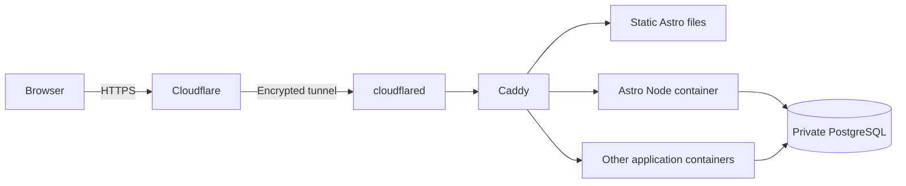

# Plan 1 — Hermes: configure the shared infrastructure

Prepared 5 October 2026. Execute this plan on `herman-1`, after verifying the host identity. Infrastructure has not been installed or changed by Codex.

**Result:** a reusable self-hosting platform with shared PostgreSQL, HTTPS ingress, and working deployment paths for static and server-rendered Astro sites. Complete and verify this platform before starting [Plan 2: set up Spooktober](spooktober-setup-plan.md).

This plan owns shared services, project onboarding, secrets, backups and operations. Application source changes, application migrations and production film data belong to Plan 2. The platform can be accepted independently of Spooktober.

## 1. Confirm inputs and inspect the host

Obtain access to the Cloudflare account/domain, two temporary verification hostnames, and an off-host backup destination. Use an existing second machine or offsite destination where available. Record the chosen domain; all `example.com` names below are placeholders.

Inspect the OS, CPU architecture, RAM, free disk, Docker/Compose, containers, networks, listening ports, databases, reverse proxies and backup jobs. Integrate with suitable existing services and preserve unrelated workloads, DNS and mail records. Keep administration through the existing SSH/private access route.

## 2. Establish the platform

Use Docker Compose v2, one shared PostgreSQL service, Caddy and a persistent Cloudflare Tunnel. The tunnel establishes outbound connections, so this design needs neither a static public IP nor router port forwarding. Public hostnames require a domain configured on Cloudflare. See the [Tunnel overview](https://developers.cloudflare.com/tunnel/) and [setup requirements](https://developers.cloudflare.com/tunnel/get-started/).



The connector establishes the tunnel outward; arrows show the visitor's request path. Static sites need neither a database nor a running Node process. Each dynamic project needing storage gets its own database and restricted credentials.

The generic application-container path also hosts Next.js SSR apps, including Spooktober, using the same private web/database networks and Caddy routing. Static and server-rendered Astro support remains part of the initial platform delivery.

Suggested layout:

```text
/srv/platform/
  compose.yaml
  caddy/Caddyfile
  scripts/                 # project provisioning, routing, deploy, rollback, backup/restore
  templates/
    astro-static/
    astro-ssr/
    container-app/         # generic service joining the shared networks
  secrets/                 # protected files, outside source control
  runbook.md
  handoff.md               # completed platform contract for application deployments
/srv/apps/<project>/       # project-specific Compose, source, releases and secrets
/srv/sites/<project>/
  releases/<release>/       # built static output
  current -> releases/<release>/
/srv/backups/postgres/      # local staging, with a separate off-host copy
```

Create shared networks once, using stable names. Separate application Compose projects join them as external networks.

| Service | Networks | Published host ports |
|---|---|---|
| `cloudflared` | `platform-edge` | None |
| `caddy` | `platform-edge`, `platform-web` | None |
| `postgres` | `platform-db` | None |
| Dynamic project | `platform-web`, plus `platform-db` when needed | None |

Make `platform-db` an internal network. Caddy does not need database access. Give every application a unique upstream alias on `platform-web`; document the PostgreSQL alias on `platform-db`. The edge network must permit outbound tunnel connections. The app web network must support outbound HTTPS and DNS for services such as external identity providers; keep the database network internal.

Pin tested image versions and record digests. Configure persistent volumes, compatible filesystem permissions, restart policies, health checks and bounded logs. Set resource budgets from the host's available capacity, reserve room for future projects, and record measured usage. Provide a small connection-pool recommendation for database applications, initially around four connections per app.

## 3. Provide PostgreSQL and project provisioning

Use the official PostgreSQL 18 image with a tested current minor release, pinned after verification, or adopt a suitable supported existing cluster. For the PostgreSQL 18 image, mount storage at `/var/lib/postgresql`; the default `PGDATA` is `/var/lib/postgresql/18/docker`. Follow the [official image documentation](https://github.com/docker-library/docs/blob/master/postgres/README.md) for the selected version.

Deliver a repeatable `provision-project` mechanism that accepts a project name and creates its database, owner/migration role and restricted runtime login. It must preserve existing databases and safely handle repeat execution. Its contract must specify how migrations grant the runtime role privileges on current and future tables/sequences. Administrator credentials stay outside application containers.

Revoke default `PUBLIC` database connection privileges and grant access explicitly. Restrict schema creation, account for default databases and existing grants, and verify that one project's runtime login cannot connect to another project's database. Use SCRAM authentication for inter-container connections; do not enable trust authentication.

Use protected files or the existing secret mechanism. The official image supports `POSTGRES_PASSWORD_FILE`. Return secret locations or reference names privately, without printing passwords, connection strings, resolved Compose configuration or tunnel tokens into reports.

Initialization scripts in the official image run only against an empty data directory. Later projects must use the provisioning mechanism; never delete populated storage to rerun initialization. Test provisioning and role isolation using two disposable project databases, then remove only those test resources.

## 4. Configure Caddy and HTTPS ingress

Create a named persistent Cloudflare Tunnel and run `cloudflared` as its own Compose service with protected credentials. Map approved hostnames to `http://caddy:80`, preserving the original hostname, with a catch-all rejection for unconfigured names.

Caddy accepts internal HTTP for these routes: Cloudflare provides public HTTPS and the tunnel encrypts the connection to the server. Use explicit HTTP site addresses to avoid redirecting the tunnel origin to HTTPS. A generic container route is:

```caddyfile
http://app.example.com {
    reverse_proxy example-app:8080
}
```

Keep normal request headers available to upstream applications, including authentication and origin headers. Configure unknown Caddy hostnames to return 404. Validate configuration before reloading. See [Caddy's reverse proxy documentation](https://caddyserver.com/docs/caddyfile/directives/reverse_proxy).

Provide a repeatable hostname-registration mechanism covering Cloudflare DNS/tunnel routing and Caddy routes. It must preserve existing routes, avoid duplicate entries, and leave existing sites available while another project is onboarded. Application-specific authentication, cache rules and public-origin settings are configured during each application's setup.

## 5. Deliver both Astro hosting modes now

**Static and server-rendered Astro hosting are initial acceptance requirements.** Provide working templates and onboarding, deploy and rollback commands for both modes.

- **Static Astro:** build using the project's lockfile, publish only `dist/` into a versioned release directory, and mount the parent project directory read-only in Caddy. Serve the `current` release with `root` and `file_server`. Switch the symlink atomically inside the mounted directory and retain the previous release.
- **Server-rendered Astro:** use the [official Node adapter](https://docs.astro.build/en/guides/integrations-guide/node/) in standalone mode. Package the browser assets and server entry point from the same build in a project container, bind to `0.0.0.0`, and proxy its internal port through Caddy. Provide health checks and versioned image references.
- Each project has explicit hostname routes and separate releases and secrets. Provision database access only when the project needs it.

Document the deployment interface: project name, hostname, source or built artifact, release identifier and optional database requirement. Validate builds and configuration before switching a release, check HTTP health afterwards, and automatically restore the previous release if the switch fails.

Deploy a minimal static Astro example and a minimal server-rendered Astro example on separate approved HTTPS hostnames. Verify static pages and built assets; verify the SSR example produces a response at request time. Test release updates and rollback for both, plus container recreation for SSR. Verify that deploying the second site leaves the first available. These examples may be temporary, but retain their templates, commands and results.

## 6. Establish backups and operations

Schedule daily custom-format PostgreSQL dumps for each project database and a globals/roles export. Register new databases with the backup job through the provisioning mechanism. Use compatible tools, propagate failures, and publish backup files only after successful completion. Protect role exports, which may contain password hashes, and encrypt off-host copies. See [PostgreSQL's dump backup guidance](https://www.postgresql.org/docs/current/backup-dump.html).

Start with seven daily, four weekly and three monthly backups, adjusted to destination capacity. Also protect infrastructure configuration, secret material and release references using the chosen private mechanism. An off-host destination is required for completion; local copies are staging. Connect failure, stale-backup, unhealthy-service and low-disk alerts to an existing authorized monitoring channel.

Restore a demonstration database into a separate test database and compare its data. Verify that scheduled backup files reach the off-host destination. Document periodic restore checks, individual-service restart, health/log inspection, project provisioning, site onboarding, deployment and rollback commands.

Verify recovery after a shared-service restart without deleting volumes. Record an explicit PostgreSQL major-upgrade procedure; changing the image tag alone is insufficient. Keep platform upgrades independent of application releases.

## 7. Return the completed infrastructure handoff

Write `/srv/platform/handoff.md` and give its location and contents to Kyle and the application agent. Record actual values, replacing the suggested names where necessary:

| Handoff item | Required information |
|---|---|
| Host and capacity | Host identity, OS, architecture, available disk/RAM, measured platform usage |
| Services | Compose/config paths, pinned versions/digests, health/log/restart commands |
| Networks | Exact shared network names, app upstream naming rules, PostgreSQL hostname/port/version |
| Project provisioning | Command and example usage, database/role naming, migration grants, secret reference mechanism |
| Site registration | Commands and examples for DNS/tunnel/Caddy onboarding and removal |
| Deployments | Static Astro, SSR Astro and generic container templates; deploy/health/rollback commands |
| Backups | Project registration, schedule, retention, off-host destination, restore command and successful test |
| Operations | Runbook location, update procedures, alert configuration and verification evidence |

Never include secret values in this handoff.

The platform is complete when:

- [ ] Shared services are healthy, persistent and recover after restart.
- [ ] Database and application listeners have no unintended host/public exposure.
- [ ] Project provisioning works and database access is isolated between test projects.
- [ ] Both Astro modes work over HTTPS and pass update/rollback checks; SSR also survives recreation.
- [ ] Onboarding another site preserves existing sites.
- [ ] Scheduled off-host backups work and a separate-database restore succeeds.
- [ ] Templates, operational commands and the completed handoff are available for Plan 2.

At this point infrastructure delivery is finished. Start Spooktober work using [Plan 2](spooktober-setup-plan.md) and the actual platform contract; that work does not block acceptance of this plan.
